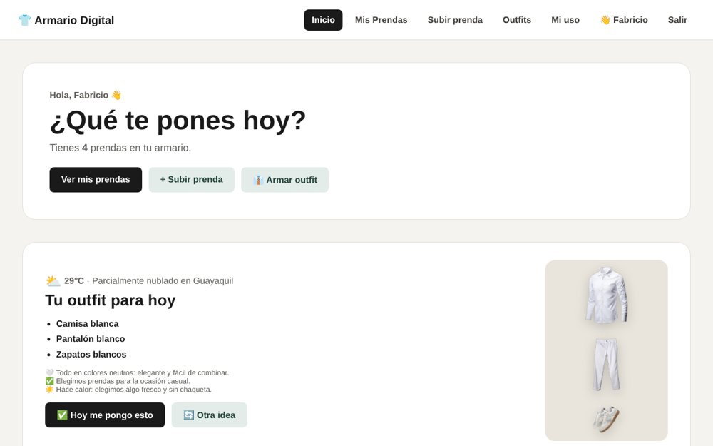
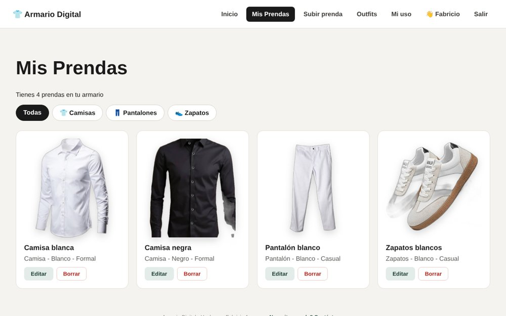
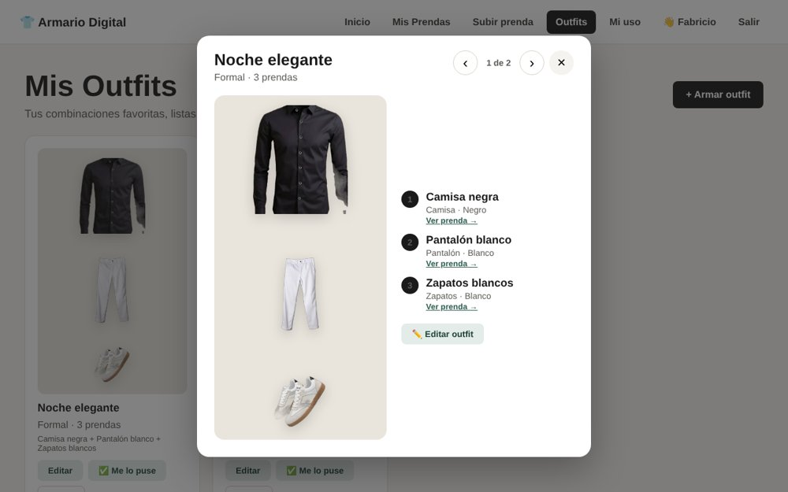
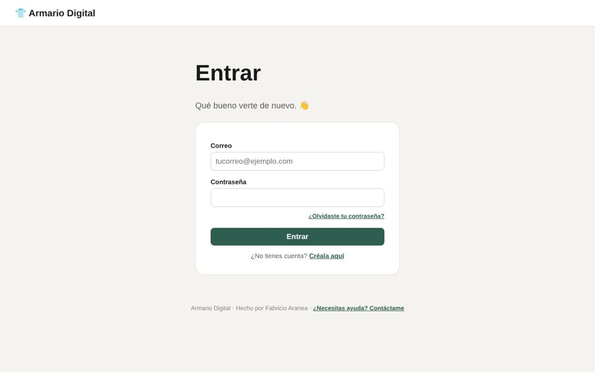

# 👕 Armario Digital

Aplicación web para organizar tu ropa: tomas fotos de tus prendas, se guardan en tu armario digital y puedes verlas todas en un solo lugar, sin abrir el clóset.

> Proyecto personal creado para practicar desarrollo web con Python.

🌐 **Pruébala en vivo:** https://fabri14.pythonanywhere.com (crea tu cuenta gratis)

## 📸 Capturas

| Inicio con el outfit del día | Mis prendas |
|---|---|
|  |  |

| Ver un outfit | Iniciar sesión |
|---|---|
|  |  |

## ✨ Funcionalidades

- 🔐 **Cuentas de usuario**: registro, inicio y cierre de sesión con contraseñas cifradas (hash)
- 🆘 **Recuperar contraseña** con un código de recuperación (guardado cifrado) y página **Mi cuenta** para cambiar la contraseña
- 📩 **Contacto de soporte** y una herramienta de administrador (`admin.py`) para restablecer cuentas
- 🙈 Cada usuario ve, edita y borra **solo su propia ropa**
- 📸 Subir prendas con foto (con vista previa), tipo, color, ocasión y nombre opcional
- ✂️ Quitar el fondo de las fotos automáticamente con IA (`rembg`)
- 👔 Armar, editar y guardar outfits combinando prendas, verlos en grande y pasar de uno a otro
- 🧹 Al borrar una prenda, avisa en qué outfits está, quita los outfits que quedan rotos y marca los incompletos
- 🎨 Color automático: si no escribes el color, la app lo detecta de la foto (Pillow + HSV)
- ✨ Sugerir outfits con reglas de moda programadas (colores neutros, ocasión)
- 📸 Consejos para tomar buenas fotos de las prendas
- 🌦️ **"¿Qué me pongo hoy?"**: el Inicio sugiere un outfit según el clima de Guayaquil (API gratuita de Open-Meteo)
- 📊 **Mi uso**: registra qué te pones cada día y muestra tus prendas favoritas y las que nunca usas
- 🗂️ 11 categorías (camisas, vestidos, tacos, bolsos...) definidas en un solo lugar del código
- 🏠 Inicio que se adapta a cada usuario: muestra solo las categorías que usa
- 🔍 Filtros por tipo de prenda
- ✏️ Editar prendas, incluida la foto, y 🗑️ borrarlas con confirmación
- 🧹 Las fotos viejas se borran del disco automáticamente
- 💬 Mensajes de confirmación y validación de datos (formato y tamaño de la foto)
- 📱 Diseño responsive: se ve bien en computadora y en celular

## 🛠️ Tecnologías

- **Python** y **Flask** (backend)
- **HTML**, **CSS** y **Jinja** (frontend y plantillas)
- **SQLite** y **SQL** (base de datos con tablas relacionadas)
- **JavaScript** (vista previa de fotos y nombre sugerido)
- **pytest** (pruebas automáticas)

## 🚀 Cómo ejecutarlo

1. Instala las librerías:
   ```
   pip install -r requirements.txt
   ```
2. Ejecuta la aplicación:
   ```
   python app.py
   ```
3. Abre en el navegador: http://127.0.0.1:5000

La base de datos (`armario.db`) se crea sola la primera vez que se ejecuta la app. La primera vez que quitas un fondo, `rembg` descarga su modelo de IA (unos 170 MB).

## 🛠️ Administrador

Desde la consola del servidor:

```
python admin.py usuarios
python admin.py restablecer correo@ejemplo.com
python admin.py limpiar
```

## 🧪 Pruebas automáticas

El proyecto tiene **50 pruebas automáticas** con `pytest` que revisan el login, la seguridad entre usuarios, las prendas, los outfits, el clima, el registro de uso y las funciones de color. Usan una base de datos temporal, así que no tocan tus datos.

```
python -m pytest -v
```

## 🗺️ Próximos pasos

- [x] Borrar y editar prendas
- [x] Cuentas de usuario
- [x] Armar y guardar outfits
- [x] Quitar el fondo de las fotos automáticamente
- [x] Detectar el color de la prenda automáticamente
- [ ] Reconocer el tipo de prenda con IA
- [ ] Publicar la app en internet

## 🤖 Uso de IA

Desarrollado con apoyo de IA (Claude) como tutor: la usé para aprender los conceptos y revisar mi código, que fui escribiendo y corrigiendo yo mismo.

## 👤 Autor

**Fabricio Aranea** — Tecnólogo en Desarrollo de Software, Guayaquil, Ecuador.
